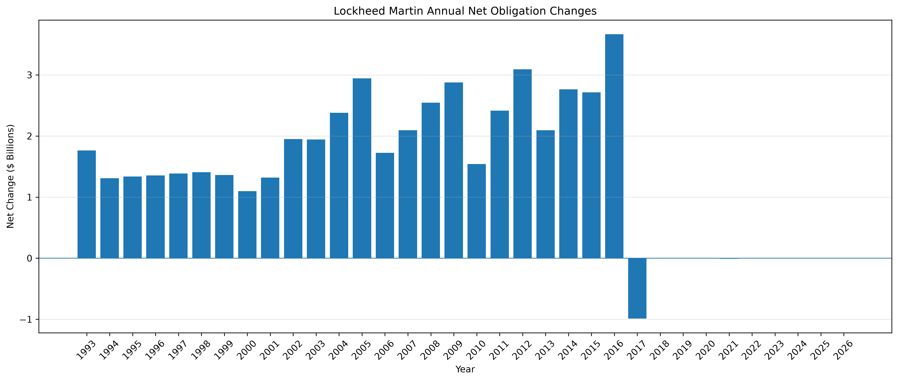
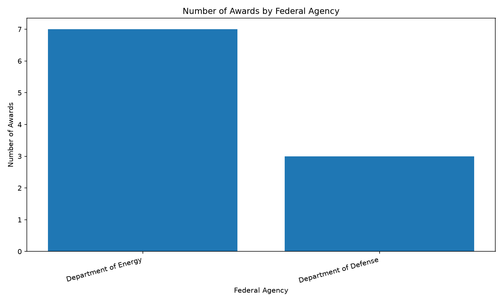
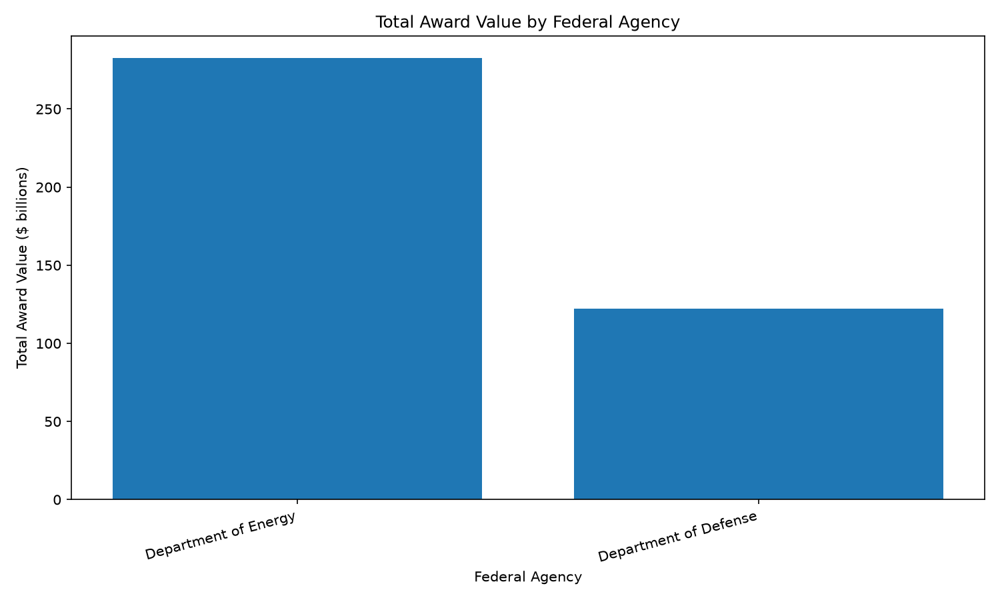

# Federal Program Performance & Spending Analytics Platform

An independent data analytics project that combines federal spending
data ingestion, data transformation, validation, PostgreSQL storage, SQL
analysis, historical contract analysis, and interactive visualization.

The project uses data from the **USAspending.gov API** to examine
federal award information and analyze historical contract obligation
changes. It demonstrates an end-to-end data workflow using Python, SQL,
PostgreSQL, Matplotlib, Plotly, and Streamlit.

------------------------------------------------------------------------

## 1. Project Overview

The Federal Program Performance & Spending Analytics Platform was
developed as an independent portfolio project to explore how federal
spending data can be collected, organized, validated, analyzed, and
presented.

The project has two primary analytical components:

1.  **Federal Award Spending Analysis**\
    Collects federal award data from the USAspending.gov API, transforms
    and validates the records, stores the results in PostgreSQL, and
    analyzes award values by agency and recipient.

2.  **Historical Contract Obligation Analysis**\
    Examines historical transaction records for a selected Department of
    Energy contract involving Lockheed Martin Corporation. The analysis
    evaluates annual and monthly obligation changes, including positive
    obligations, negative obligations, and cumulative contract values.

The project also includes a Streamlit dashboard, static visualizations,
interactive HTML reports, CSV exports, and automated tests.

### Project Objectives

-   Retrieve federal award information through a public government API.
-   Build a repeatable data ingestion and transformation workflow.
-   Apply data validation and quality checks.
-   Store structured federal award data in PostgreSQL.
-   Use SQL and Python to analyze agency and recipient spending.
-   Examine historical contract obligations and financial changes.
-   Create visualizations that communicate financial trends.
-   Develop an interactive dashboard for exploring analytical results.
-   Apply automated testing to important data pipeline components.

------------------------------------------------------------------------

## 2. Technology Stack

  Category                 Technologies
  ------------------------ -------------------------------------------
  Programming Language     Python
  Data Manipulation        pandas, NumPy
  Database                 PostgreSQL
  SQL                      PostgreSQL SQL
  API Integration          USAspending.gov API, requests
  Data Validation          Python, Pydantic
  Data Visualization       Matplotlib, Plotly
  Interactive Dashboard    Streamlit
  Testing                  pytest
  Database Connectivity    SQLAlchemy, psycopg2
  Environment Management   Python virtual environment, python-dotenv
  Version Control          Git, GitHub

------------------------------------------------------------------------

## 3. Data Source and API Integration

The federal award dataset is retrieved from the public USAspending.gov
API.

-   **Data source:** [USAspending.gov](https://www.usaspending.gov/)
-   **API documentation:** [USAspending
    API](https://api.usaspending.gov/)

The ingestion component is located at:

`src/ingestion/usa_spending_api.py`

The project uses the following API endpoint:

`/api/v2/search/spending_by_award/`

The API request retrieves a sample of federal award records using
award-type filters and award amount sorting.

### API Request Configuration

The request configuration includes:

-   Award type codes: A, B, C, and D.
-   Funding field: Total Outlays.
-   Result limit: 10 records.
-   Sorting: Award amount, descending.
-   Request timeout: 30 seconds.

The API response is saved as a raw JSON file before transformation.

### Data Retrieval Workflow

1.  Send a request to the USAspending.gov API.
2.  Retrieve the federal award records.
3.  Save the raw API response.
4.  Transform the records into a structured dataset.
5.  Validate the transformed data.
6.  Load the validated records into PostgreSQL.
7.  Perform SQL and Python analysis.
8.  Present the results through visualizations and a dashboard.

------------------------------------------------------------------------

## 4. ETL Pipeline

The project follows an ETL workflow: Extract, Transform, and Load.

### Extract

The ingestion module retrieves award information from the
USAspending.gov API.

**File:** `src/ingestion/usa_spending_api.py`

The raw API response is saved in:

`data/raw/awards_sample.json`

### Transform

The transformation module converts the API response into a structured
dataset.

**File:** `src/transformation/clean_awards.py`

The cleaning process prepares the records for analysis and database
storage.

The transformed dataset includes fields such as:

-   `internal_id`
-   `award_id`
-   `recipient_name`
-   `award_amount`
-   `generated_internal_id`
-   `awarding_agency`
-   `start_date`
-   `end_date`
-   `description`

### Validate

The validation module checks the transformed records before database
loading.

**File:** `src/transformation/validate_awards.py`

The validation process checks required fields and applies data quality
rules, including:

-   Required field validation.
-   Unique internal identifiers.
-   Duplicate award ID checks.
-   Nonnegative award amount checks.
-   Basic data consistency.

### Load

The database module loads validated award records into PostgreSQL.

**File:** `src/database/load_awards.py`

The database loading process uses an upsert approach based on the
internal identifier to help prevent duplicate records when records are
loaded again.

### ETL Summary

``` text
USAspending.gov API
        |
        v
Data Ingestion
        |
        v
Raw JSON Data
        |
        v
Data Cleaning
        |
        v
Data Validation
        |
        v
PostgreSQL Database
        |
        v
SQL and Python Analysis
        |
        v
Visualizations and Dashboard
```

------------------------------------------------------------------------

## 5. PostgreSQL Database Architecture

The project uses PostgreSQL to store and query structured federal award
information.

-   **Database:** `federal_spending`
-   **Primary table:** `awards`

### Awards Table

The `awards` table contains the following fields:

  Column                    Data Type       Description
  ------------------------- --------------- -------------------------------
  `internal_id`             BIGINT          Primary identifier
  `award_id`                TEXT            Federal award identifier
  `recipient_name`          TEXT            Award recipient
  `award_amount`            NUMERIC(15,2)   Award amount
  `generated_internal_id`   TEXT            Generated internal identifier
  `awarding_agency`         TEXT            Federal awarding agency
  `start_date`              DATE            Award start date
  `end_date`                DATE            Award end date
  `description`             TEXT            Award description

The `internal_id` field is the primary key.

### Database Analysis

The project uses SQL queries and database views to summarize award
information.

Examples of analytical questions include:

-   How many federal awards are stored in the database?
-   How many unique award identifiers exist?
-   What is the total award value?
-   Which agencies have the highest award values?
-   Which recipients have the largest awards?
-   What percentage of the total award value is associated with each
    agency?

Agency and recipient summaries are used to support the analytical and
dashboard components.

------------------------------------------------------------------------

## 6. Federal Award Spending Analysis

The federal award analysis examines the sample of records retrieved from
USAspending.gov.

The analysis focuses on award amounts, awarding agencies, and
recipients.

### Key Analytical Measures

-   Total number of awards.
-   Number of distinct award identifiers.
-   Total award value.
-   Average award value.
-   Largest award value.
-   Award value by federal agency.
-   Award value by recipient.

### Sample Dataset Results

The latest sample analysis produced the following results:

  Metric                                Result
  --------------------- ----------------------
  Total Awards                              10
  Distinct Award IDs                        10
  Total Award Value       \$404,739,667,534.78
  Average Award Value      \$40,473,966,753.48
  Largest Award Value      \$51,269,205,263.03

These figures describe the sample of records retrieved for this project.
They should not be interpreted as total federal government spending.

### Agency-Level Analysis

Agency-level analysis groups award records by awarding agency to compare
the distribution of award values.

The analysis helps answer questions such as:

-   Which agencies account for the largest award values in the sample?
-   How is the sample award value distributed across agencies?
-   What percentage of the sample total is associated with each agency?

### Recipient-Level Analysis

Recipient analysis groups award records by recipient to identify
organizations associated with the largest award values.

This supports comparisons of award values across recipients.

### Related Files

-   `src/analytics/agency_analysis.py`
-   `src/analytics/visualize_spending.py`

------------------------------------------------------------------------

## 7. Historical Contract Obligation Analysis

The second analytical component examines historical transaction records
associated with a selected Department of Energy contract involving
Lockheed Martin Corporation.

The transaction dataset is stored locally at:

`data/raw/lockheed_award_transactions.json`

This raw transaction file is not included in the public GitHub
repository.

The historical analysis uses the transaction records to examine changes
in federal contract obligations over time.

### Transaction Data

The transaction records include fields such as:

-   Transaction ID.
-   Award ID.
-   Action date.
-   Action type description.
-   Modification number.
-   Transaction description.
-   Federal action obligation.

The dataset contains 594 transaction records covering the period from
October 15, 1993, through July 7, 2026.

All 594 records were associated with the selected award identifier.

### Understanding Federal Contract Obligations

A federal contract obligation represents the government's commitment of
funds for a contract.

A transaction can increase or decrease the cumulative obligated amount.

**Positive obligations**

Positive values generally represent additional funds obligated to the
contract.

**Negative obligations**

Negative values generally represent reductions in previously obligated
funds, commonly referred to as deobligations.

**Net obligation change**

Net obligation change is calculated by combining positive and negative
transaction amounts.

``` text
Net Obligation Change =
Gross Positive Obligations + Gross Negative Obligations
```

For example:

``` text
Gross Positive Obligations:   $500,000,000
Gross Negative Obligations:  -$200,000,000
                             --------------
Net Obligation Change:        $300,000,000
```

A negative net obligation change indicates that reductions exceeded
additional obligations during the period.

**Important distinction:** Contract obligations and outlays are
different financial measures. Obligations represent commitments of
funds, while outlays represent payments made by the government.

------------------------------------------------------------------------

## 8. Annual Obligation Analysis

The annual analysis groups historical contract transactions by year.

The analysis examines:

-   Annual positive obligations.
-   Annual negative obligations.
-   Net annual obligation changes.
-   Annual cumulative obligation values.
-   Year-over-year changes.

The purpose is to identify years with significant increases or
reductions in the contract's obligated amount.

### Annual Analysis Questions

-   Which years had the largest positive obligation changes?
-   Which years had the largest negative obligation changes?
-   How did annual net obligation changes affect cumulative obligations?
-   Which years experienced reductions in total obligations?
-   How did the contract's financial profile change over time?

### Related File

`src/analysis/lockheed_annual_analysis.py`

### Annual Visualization


------------------------------------------------------------------------

## 9. Monthly Obligation Analysis: 2017

The project includes a more detailed monthly examination of contract
transactions during 2017.

This analysis compares monthly positive and negative obligations and
calculates the resulting net change.

### 2017 Results

  Metric                                          Result
  -------------------------------- ---------------------
  Opening Cumulative Obligations     \$49,079,828,101.11
  Ending Cumulative Obligations      \$48,090,105,709.94
  Net Obligation Change                -\$989,722,391.17
  Percentage Change                               -2.02%
  Gross Positive Obligations            \$516,070,700.39
  Gross Negative Obligations         -\$1,505,793,091.56
  Positive Transactions                                7
  Negative Transactions                                8

The 2017 analysis shows that negative obligations exceeded positive
obligations, resulting in a net reduction of approximately \$989.7
million.

### Significant Monthly Changes

May 2017 experienced the largest monthly net reduction.

  Measure                                              Amount
  ------------------------------------- ---------------------
  May 2017 Net Change                     -\$1,347,149,687.35
  Net Change Across Other 2017 Months        \$357,427,296.18

Two transactions accounted for most of the gross negative obligations in
May:

  Modification   Date           Federal Action Obligation
  -------------- ------------ ---------------------------
  652            2017-05-30             -\$792,802,785.58
  653            2017-05-31             -\$554,346,901.77

Both transactions included descriptions referencing Lockheed Martin
Corporation as the new contracting party.

The two transactions accounted for approximately 89.46% of the gross
negative obligations recorded during 2017.

These findings identify significant transaction-level changes for
further investigation. They do not, by themselves, establish the
underlying business or administrative reasons for those changes.

### Monthly Analysis Visualizations

#### Monthly Obligation Changes


#### Cumulative Obligations


#### Positive and Negative Obligations


### Related File

`src/analysis/lockheed_monthly_analysis.py`

------------------------------------------------------------------------

## 10. Historical Financial Overview and Rankings

The project includes additional historical analysis to compare contract
obligation activity across the full transaction history.

The historical analysis examines:

-   Gross positive obligations.
-   Gross negative obligations.
-   Net obligation changes.
-   Cumulative obligation trends.
-   Historical annual rankings.
-   Recent financial activity.

The ranking analysis identifies the years with the largest values in
selected financial categories.

This makes it possible to compare years based on different measures
rather than relying only on net obligation changes.

### Historical Visualizations

#### Historical Financial Overview


#### Recent Financial Overview


#### Historical Cumulative Obligations


#### Gross Positive Obligations


#### Gross Negative Obligations


#### Net Obligation Changes



### Historical Analysis Files

-   `src/analysis/lockheed_historical_ranking.py`
-   `src/analysis/lockheed_historical_visualization.py`
-   `src/analysis/lockheed_annual_obligations_chart.py`

### Historical Analysis Outputs

-   `reports/lockheed_historical_rankings.csv`
-   `reports/lockheed_annual_obligation_analysis.csv`
-   `reports/lockheed_monthly_obligation_analysis.csv`

Interactive HTML reports are also available in the `reports/` directory.

------------------------------------------------------------------------

## 11. Interactive Streamlit Dashboard

The project includes an interactive dashboard built with Streamlit and
Plotly.

**Dashboard file:**

`dashboards/spending_dashboard.py`

The dashboard provides an interface for exploring federal award
information and analytical results.

### Dashboard Features

-   Federal award summary metrics.
-   Agency-level spending analysis.
-   Recipient-level spending analysis.
-   Interactive charts.
-   Data filtering.
-   CSV export functionality.
-   Data quality checks.
-   Historical contract analysis.
-   Explanatory notes about data limitations.

The dashboard is designed to make the results easier to explore without
requiring users to run individual SQL queries or analysis scripts.

### Dashboard Technologies

-   Streamlit
-   Plotly
-   pandas
-   PostgreSQL

------------------------------------------------------------------------

## 12. Visualizations and Reports

The project generates static visualizations, interactive HTML reports,
and CSV analytical outputs.

These reports provide additional ways to explore federal award
distributions and historical contract obligation activity.

### Federal Award Analysis

#### Number of Awards by Agency



#### Total Award Value by Agency



### Interactive Historical Analysis Reports

The repository includes four interactive HTML reports generated
from historical contract transaction data.

These reports can be downloaded and opened locally in a web browser.

| Report | Description |
|---|---|
| [Annual Positive and Negative Obligations](reports/annual_positive_negative_obligations.html) | Compares annual gross positive and negative obligations. |
| [Gross Positive Obligations](reports/lockheed_gross_positive_obligations.html) | Examines annual positive obligation activity. |
| [Gross Negative Obligations](reports/lockheed_gross_negative_obligations.html) | Examines annual negative obligation activity and reductions. |
| [Net Obligation Changes](reports/lockheed_net_obligation_changes.html) | Examines annual net changes in contract obligations. |

### Analytical Data Exports

The project also generates CSV files containing analytical results:

- `reports/lockheed_annual_obligation_analysis.csv`
- `reports/lockheed_monthly_obligation_analysis.csv`
- `reports/lockheed_historical_rankings.csv`

These outputs support further analysis and independent examination
of historical contract financial activity.

The visualizations and reports complement the analytical findings
presented in Sections 8, 9, and 10.
------------------------------------------------------------------------

## 13. Project Structure

The following structure reflects the files tracked in the GitHub
repository, including the application, data pipeline, analytical
modules, automated tests, dashboard, and generated reports.

```text
federal_spending_analytics/
│
├── dashboards/
│   └── spending_dashboard.py
│
├── data/
│   ├── raw/
│   │   ├── awards_sample.json
│   │   └── .gitkeep
│   │
│   └── processed/
│       ├── awards_sample.csv
│       ├── agency_spending_summary.csv
│       ├── recipient_spending_summary.csv
│       └── .gitkeep
│
├── reports/
│   ├── 2017_cumulative_obligations.png
│   ├── 2017_monthly_obligations.png
│   ├── annual_obligation_analysis.png
│   ├── annual_positive_negative_obligations.html
│   ├── lockheed_annual_obligation_analysis.csv
│   ├── lockheed_cumulative_obligations_history.png
│   ├── lockheed_gross_negative_obligations.html
│   ├── lockheed_gross_negative_obligations.png
│   ├── lockheed_gross_positive_obligations.html
│   ├── lockheed_gross_positive_obligations.png
│   ├── lockheed_historical_financial_overview.png
│   ├── lockheed_historical_rankings.csv
│   ├── lockheed_monthly_obligation_analysis.csv
│   ├── lockheed_net_obligation_changes.html
│   ├── lockheed_net_obligation_changes.png
│   ├── lockheed_recent_financial_overview.png
│   ├── monthly_positive_negative_2017.png
│   ├── number_of_awards_by_agency.png
│   └── total_award_value_by_agency.png
│
├── scripts/
│   └── diagnostics/
│       ├── check_award_outlays.py
│       ├── check_database_connection.py
│       └── inspect_electric_boat.py
│
├── src/
│   ├── __init__.py
│   │
│   ├── analysis/
│   │   ├── lockheed_annual_analysis.py
│   │   ├── lockheed_annual_obligations_chart.py
│   │   ├── lockheed_historical_ranking.py
│   │   ├── lockheed_historical_visualization.py
│   │   └── lockheed_monthly_analysis.py
│   │
│   ├── analytics/
│   │   ├── __init__.py
│   │   ├── agency_analysis.py
│   │   └── visualize_spending.py
│   │
│   ├── database/
│   │   ├── __init__.py
│   │   └── load_awards.py
│   │
│   ├── ingestion/
│   │   ├── __init__.py
│   │   └── usa_spending_api.py
│   │
│   ├── run/
│   │   ├── __init__.py
│   │   └── pipeline.py
│   │
│   ├── transformation/
│   │   ├── __init__.py
│   │   ├── clean_awards.py
│   │   └── validate_awards.py
│   │
│   └── main.py
│
├── tests/
│   ├── __init__.py
│   ├── test_clean_awards.py
│   ├── test_load_awards.py
│   ├── test_usa_spending_api.py
│   └── test_validate_awards.py
│
├── .env.example
├── .gitignore
├── README.md
└── requirements.txt
```

**Note:** This structure reflects the files tracked in the GitHub
repository. Local environment files (.env), virtual environments,
Python cache directories, and the raw Lockheed Martin transaction
dataset are excluded through .gitignore. The processed data and
analysis reports shown above are committed project outputs.
------------------------------------------------------------------------

## 14. Installation and Environment Setup

### Requirements

-   Python
-   PostgreSQL
-   Git
-   A USAspending.gov API connection

### Clone the Repository

``` bash
git clone https://github.com/saltanikamal/federal-program-performance-analytics.git
cd federal-program-performance-analytics
```

### Create a Virtual Environment

On macOS or Linux:

``` bash
python3 -m venv venv
source venv/bin/activate
```

### Install Dependencies

``` bash
pip install --upgrade pip
pip install -r requirements.txt
```

### Configure Environment Variables

Create a local `.env` file for database connection settings and any
other required configuration.

Do not commit `.env` files, passwords, API credentials, or other secrets
to GitHub.

The actual environment variable names should match those used by the
project's configuration and database connection code.

### Configure PostgreSQL

Create or configure the PostgreSQL database used by the application.

The database used during development is:

`federal_spending`

Make sure PostgreSQL is running and that the database connection
settings in the local environment match the database configuration.

------------------------------------------------------------------------

## 15. Running the Project

Activate the virtual environment before running project commands:

``` bash
source venv/bin/activate
```

### Run the Streamlit Dashboard

From the project root:

``` bash
streamlit run dashboards/spending_dashboard.py
```

Streamlit will display a local address in the terminal. Open that
address in a browser to use the dashboard.

### Run Automated Tests

From the project root:

``` bash
pytest
```

To display more detailed test output:

``` bash
pytest -v
```

### Run Analysis Scripts

The historical analysis scripts are located in:

`src/analysis/`

The federal award analysis modules are located in:

`src/analytics/`

Run individual scripts from the project root using the appropriate
Python command and configuration required by each script.

------------------------------------------------------------------------

## 16. Automated Testing

The project includes automated tests using pytest.

The test suite covers important components of the federal award data
workflow.

### Test Files

  Test File                          Purpose
  ---------------------------------- --------------------------------------
  `tests/test_clean_awards.py`       Tests award data cleaning
  `tests/test_load_awards.py`        Tests database loading functionality
  `tests/test_usa_spending_api.py`   Tests API ingestion behavior
  `tests/test_validate_awards.py`    Tests award data validation

### Running the Tests

``` bash
pytest -v
```

The test suite was previously verified with 19 passing tests. Run the
command above against the current checkout to confirm the latest test
results.

Automated testing helps identify problems in data cleaning, API
handling, validation, and database loading before relying on the
pipeline's output.

------------------------------------------------------------------------

## 17. Data Limitations and Considerations

The results in this repository should be interpreted within the scope of
the available datasets.

### Federal Award Sample

The federal award analysis uses a limited sample of 10 records retrieved
from USAspending.gov.

The sample is useful for demonstrating API ingestion, transformation,
validation, database loading, and analytical techniques. It is not a
comprehensive representation of all federal awards or total federal
spending.

### Historical Contract Transactions

The historical contract analysis uses transaction records for one
selected award.

The findings describe the transaction data available for that award and
should not be generalized to all Department of Energy contracts or all
federal contracts.

### Obligations and Outlays

Obligations and outlays represent different stages of federal spending.

-   Obligations represent commitments of federal funds.
-   Outlays represent payments made by the government.

They should not be treated as interchangeable measures.

### Transaction Interpretation

Negative obligations are treated as reductions in previously recorded
obligations for the purpose of this analysis.

Transaction descriptions can provide useful context, but the numerical
analysis alone does not establish the administrative or business reason
behind a contract modification.

### Data Updates

USAspending.gov data may change as records are updated. Re-running the
API workflow at a later date may produce different sample records and
results.

------------------------------------------------------------------------

## 18. Skills Demonstrated

This independent portfolio project demonstrates practical experience
with:

-   Python programming.
-   REST API data ingestion.
-   ETL pipeline development.
-   Data cleaning and transformation.
-   Data validation and quality checks.
-   PostgreSQL database design and querying.
-   SQL aggregation and analytical queries.
-   Financial and federal spending analysis.
-   Time-series and historical transaction analysis.
-   Positive, negative, and net obligation calculations.
-   Matplotlib data visualization.
-   Plotly interactive reporting.
-   Streamlit dashboard development.
-   Automated testing with pytest.
-   Git and GitHub version control.

------------------------------------------------------------------------

## 19. Future Improvements

Potential future enhancements include:

-   Expanding the federal award dataset beyond the initial sample.
-   Adding pagination and broader API retrieval.
-   Scheduling regular data ingestion.
-   Expanding data quality monitoring.
-   Adding more agency and recipient comparisons.
-   Improving dashboard filtering and reporting.
-   Adding additional historical contract comparisons.
-   Developing more automated integration tests.
-   Adding documentation for database views and analytical SQL queries.

------------------------------------------------------------------------

## 20. Repository

**GitHub Repository:**

https://github.com/saltanikamal/federal-program-performance-analytics

**Project Title:** Federal Program Performance & Spending Analytics
Platform

**Project Type:** Independent Data Science and Analytics Portfolio
Project

**Focus Areas:** Federal Spending Analytics \| Data Engineering \|
Python \| SQL \| PostgreSQL \| Financial Analysis \| Data Visualization
\| Dashboard Development
