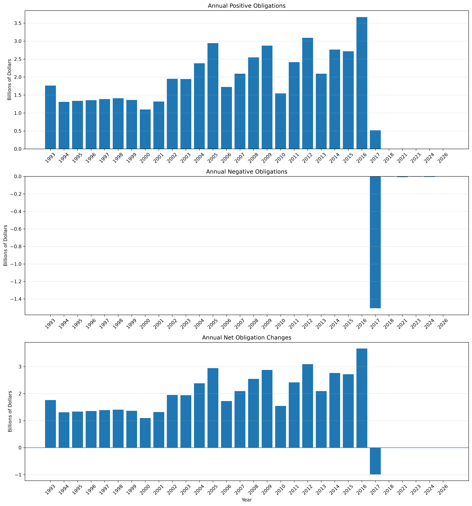
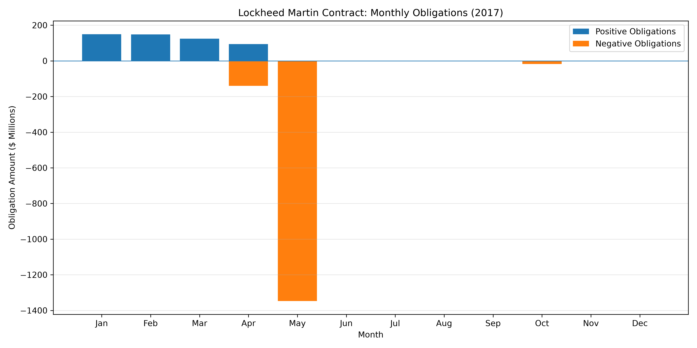
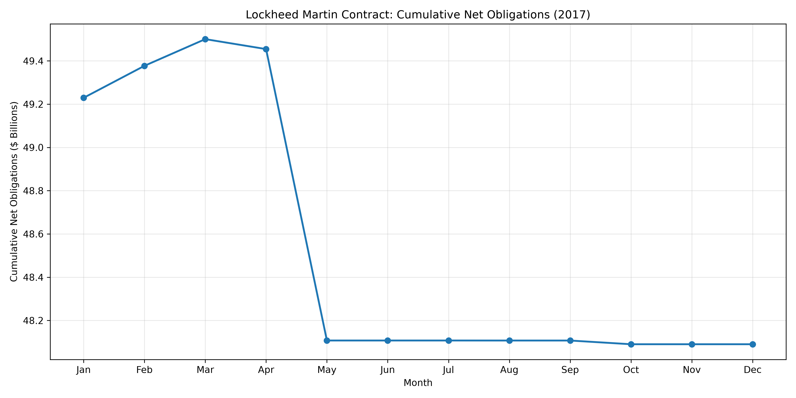
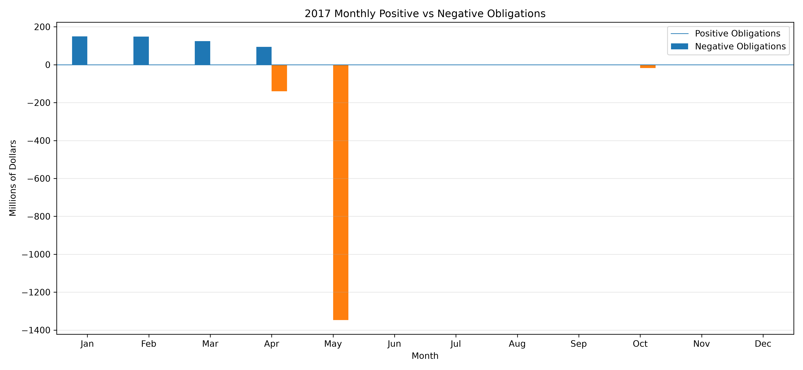
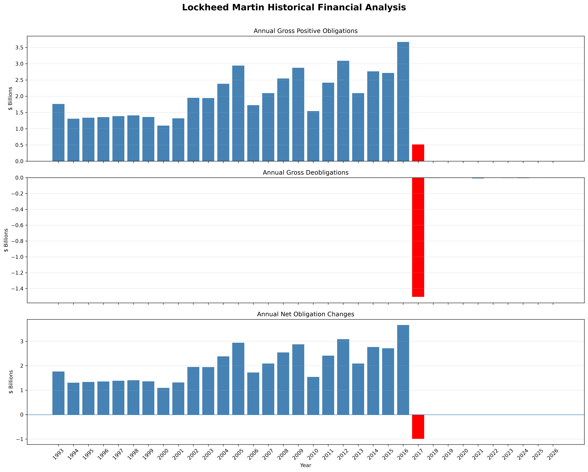
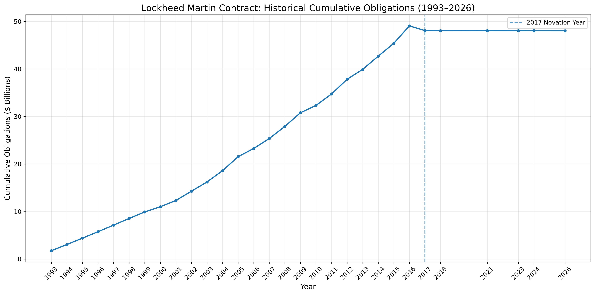
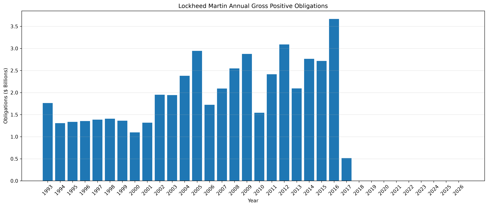
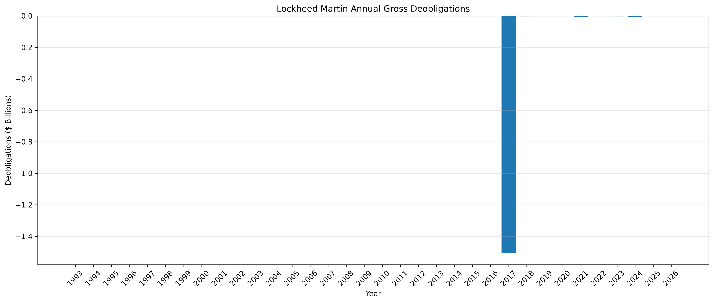

# Federal Program Performance & Spending Analytics Platform

An independent data analytics portfolio project that collects, transforms, validates, stores, and analyzes federal spending data from the USAspending.gov API.

The platform demonstrates an end-to-end data analytics workflow using Python, SQL, PostgreSQL, data validation, exploratory analysis, and interactive dashboards. It also includes a historical investigation of federal contract obligations and deobligations associated with a Department of Energy contract awarded to Lockheed Martin Corporation.

---

## 1. Project Overview

Federal spending data provides insight into how government agencies distribute funding, manage contracts, and allocate financial resources.

This project uses publicly available federal award data to examine:

- Federal award distribution across government agencies.
- Total award values and recipient concentration.
- Federal contract obligation trends.
- Positive and negative obligation adjustments.
- Historical changes in contract funding.
- Significant contract modifications and deobligations.

The project combines data engineering and analytical techniques to transform raw government spending records into structured datasets, SQL-based analysis, and visual reports.

### Project Objectives

1. Retrieve federal award information through the USAspending.gov API.
2. Build a repeatable data ingestion and transformation pipeline.
3. Clean and validate raw federal spending records.
4. Store structured award data in PostgreSQL.
5. Perform SQL-based spending analysis.
6. Develop an interactive Streamlit dashboard.
7. Investigate historical contract obligations and deobligations.
8. Communicate findings through visualizations and analytical reports.

---

## 2. Technology Stack

| Category | Technologies |
|---|---|
| Programming | Python |
| Data Analysis | pandas, NumPy |
| Data Visualization | Matplotlib, Plotly |
| Database | PostgreSQL |
| Query Language | SQL |
| Dashboard | Streamlit |
| API Integration | USAspending.gov REST API, Requests |
| Data Validation | Python, pytest |
| Data Processing | JSON, CSV |
| Environment Management | Python virtual environment, python-dotenv |
| Version Control | Git, GitHub |

---

## 3. Data Source

### USAspending.gov API

The project retrieves publicly available federal award information from the USAspending.gov REST API.

API endpoint:

https://api.usaspending.gov/api/v2/search/spending_by_award/

The API provides information about federal awards, including:

- Award identification numbers.
- Recipient names.
- Award amounts.
- Awarding agencies.
- Award descriptions.
- Award start and end dates.

The award search uses four award type codes:

| Award Type Code | Category |
|---|---|
| A | Procurement Contract |
| B | Procurement Contract |
| C | Procurement Contract |
| D | Procurement Contract |

The API response is saved as raw JSON before processing.

### Data Workflow

```text
USAspending.gov API
        |
        v
    Raw JSON
        |
        v
  Data Cleaning
        |
        v
 Data Validation
        |
        v
 Processed CSV
        |
        v
   PostgreSQL
        |
        v
   SQL Analysis
        |
        v
    Dashboard
```

---

## 4. Data Engineering Pipeline

The project implements an end-to-end data processing workflow.

### Step 1: Data Ingestion

Python retrieves federal award records through the USAspending.gov REST API.

The ingestion process:

- Sends API requests.
- Retrieves federal award information.
- Handles request timeouts.
- Saves the original API response as JSON.
- Preserves raw data for subsequent processing.

### Step 2: Data Cleaning

The transformation process uses pandas to prepare the award dataset.

Cleaning operations include:

- Selecting relevant fields.
- Standardizing column names.
- Handling missing values.
- Converting award amounts into numeric values.
- Preparing dates for analysis.
- Removing unnecessary fields.

### Step 3: Data Validation

The validation process checks the quality and consistency of the processed dataset.

Validation includes:

- Required field checks.
- Missing value checks.
- Duplicate award identification.
- Unique internal identifier checks.
- Nonnegative award amount checks.
- Data consistency checks.

Automated tests verify important pipeline functions.

### Step 4: PostgreSQL Database

Validated award records are loaded into PostgreSQL.

**Database:** `federal_spending`

**Main table:** `awards`

| Column | Description |
|---|---|
| `internal_id` | Primary key for the award record |
| `award_id` | Federal award identification number |
| `recipient_name` | Award recipient |
| `award_amount` | Total award amount |
| `generated_internal_id` | Generated record identifier |
| `awarding_agency` | Federal awarding agency |
| `start_date` | Award start date |
| `end_date` | Award end date |
| `description` | Award description |

The database uses an upsert process to manage existing records and avoid duplicate internal identifiers.

### Step 5: SQL Analytics

SQL queries are used to examine:

- Total award counts.
- Distinct award counts.
- Total award values.
- Average award values.
- Spending distribution by agency.
- Spending distribution by recipient.
- Agency and recipient rankings.

### Step 6: Dashboard Development

An interactive Streamlit dashboard provides an accessible interface for exploring federal award information.

Dashboard functionality includes:

- Summary metrics.
- Award-level information.
- Agency-level analysis.
- Recipient-level analysis.
- Interactive filtering.
- Data export to CSV.
- Data quality information.
- Spending visualizations.

---

## 5. Federal Award Dataset Results

The initial processed dataset contains 10 federal award records.

### Dataset Summary

| Metric | Result |
|---|---:|
| Total award records | 10 |
| Distinct award IDs | 10 |
| Total award value | $404,739,667,534.78 |
| Average award value | $40,473,966,753.48 |
| Largest individual award | $51,269,205,263.03 |

### Data Quality Observations

The processed dataset contains 10 distinct award records.

The pipeline validates award identifiers, required fields, numeric award amounts, and record consistency before loading the data into PostgreSQL.

**Important limitation:** This is a small analytical sample, not a comprehensive representation of all federal spending. The results describe the selected award records rather than total federal government expenditures.

---

## 6. Federal Award Spending Analysis

The award analysis examines the distribution of federal contract values across agencies and recipients.

### Analytical Objectives

- Identify agencies with the largest award values.
- Compare award counts across agencies.
- Rank recipients by award value.
- Examine the concentration of federal contract awards.

### Agency-Level Analysis

The project produces agency-level summaries containing:

- Number of awards.
- Total award value.
- Average award value.
- Percentage of total award value.

### Recipient-Level Analysis

Recipient-level analysis examines:

- Total awards received.
- Aggregate award values.
- Recipient rankings.
- Concentration of award values among recipients.

The results are stored in processed CSV files and used by the dashboard.

---

## 7. Lockheed Martin Contract Analysis

### Historical Contract Investigation

A second analytical component investigates historical obligation activity associated with a Department of Energy contract awarded to Lockheed Martin Corporation.

**Contract Award ID:** `DEAC0494AL85000`

The analysis examines 594 historical contract transactions spanning:

**October 15, 1993 – July 7, 2026**

The transaction dataset includes:

- Transaction identifiers.
- Action dates.
- Action type descriptions.
- Modification numbers.
- Federal action obligations.
- Transaction descriptions.

The objective is to understand how the contract's financial obligations changed over time.

### Understanding Federal Obligations

Federal contract obligations represent the government's legally binding financial commitments.

A positive obligation generally increases the amount committed to a contract.

A negative obligation generally represents a reduction or deobligation of previously recorded commitments. These adjustments can result from contract modifications, funding changes, administrative actions, or other contractual events.

**Obligations are not the same as actual payments or outlays.**

---

## 8. Historical Obligation Analysis

Annual analysis aggregates contract transactions by calendar year.

The analysis calculates:

- Gross positive obligations.
- Gross negative obligations.
- Annual net obligation changes.
- Cumulative obligations.
- Year-over-year changes.

The purpose is to identify years with significant funding increases or reductions.

### Historical Transaction Results

| Metric | Result |
|---|---:|
| Total transactions | 594 |
| Historical period | 1993–2026 |

The analysis separates positive and negative transactions to distinguish new funding commitments from reductions in previously recorded obligations.

This distinction provides a more complete understanding of historical contract funding activity than examining net changes alone.

### Key Historical Finding

2017 was an exceptional year in the contract's obligation history.

The investigation identified approximately $1.506 billion in negative obligation adjustments during 2017.

This represented approximately 98.07% of the historical gross negative obligations identified in the 594-transaction dataset.

The finding led to a more detailed investigation of monthly activity and individual contract modifications.

---

## 9. Detailed 2017 Obligation Analysis

### Annual Results

The 2017 analysis identified a significant net reduction in contract obligations.

| Metric | Result |
|---|---:|
| Opening cumulative obligations | $49,079,828,101.11 |
| Ending cumulative obligations | $48,090,105,709.94 |
| Gross positive obligations | $516,070,700.39 |
| Gross negative obligations | -$1,505,793,091.56 |
| Net annual obligation change | -$989,722,391.17 |
| Percentage change | -2.02% |

The contract experienced a net obligation reduction of approximately $989.7 million during 2017.

### Monthly Analysis

Monthly transaction aggregation identified May 2017 as the primary driver of the annual reduction.

| Metric | Amount |
|---|---:|
| May 2017 net obligation change | -$1,347,149,687.35 |
| All other months combined | $357,427,296.18 |
| Full-year net obligation change | -$989,722,391.17 |

**Reconciliation:**

```text
May 2017 + All Other Months = Full-Year Net Change

-$1,347,149,687.35
+  $357,427,296.18
-------------------
  -$989,722,391.17
```

The monthly results reconcile exactly with the annual analysis.

### Monthly Transaction Distribution

| Transaction Category | Count |
|---|---:|
| Months with positive net changes | 7 |
| Months with negative net changes | 8 |

May was the dominant negative month, while the remaining months collectively offset part of the reduction.

---

## 10. Investigation of Major May 2017 Transactions

The next stage examined the individual transactions responsible for the unusually large May reduction.

Three important modifications were identified.

| Action Date | Modification | Action Type | Federal Action Obligation |
|---|---:|---|---:|
| 2017-05-05 | 651 | Novation Agreement | $0.00 |
| 2017-05-30 | 652 | Funding Only Action | -$792,802,785.58 |
| 2017-05-31 | 653 | Funding Only Action | -$554,346,901.77 |

The two largest negative transactions occurred immediately after the May 5 novation agreement.

Both major transactions included descriptions identifying Lockheed Martin Corporation as the new contracting party.

### Major Transaction Findings

| Metric | Result |
|---|---:|
| First major reduction | -$792,802,785.58 |
| Second major reduction | -$554,346,901.77 |
| Combined reduction | -$1,347,149,687.35 |
| Share of 2017 gross negative obligations | 89.46% |
| Share of historical gross negative obligations | 87.74% |

These two transactions account for approximately 89.46% of all negative obligations recorded during 2017.

They also represent approximately 87.74% of all historical negative obligations in the transaction dataset.

### After-Novation Transaction Analysis

The five transactions following the novation-related activity showed:

| Metric | Result |
|---|---:|
| Transactions examined | 5 |
| Positive transactions | 0 |
| Net obligation change | -$1,364,409,755.27 |

The transaction descriptions and timing suggest a significant relationship between the contractor transition and the subsequent funding adjustments.

However, transaction descriptions alone do not establish the complete legal or financial reason for the reductions. The analysis identifies the timing and magnitude of the changes without claiming an independently verified contractual explanation.

---

## 11. Key Analytical Findings

The historical investigation produced several important findings.

### Finding 1: Historical Negative Obligations Were Highly Concentrated

Approximately 98.07% of the historical gross negative obligations occurred in 2017.

### Finding 2: May 2017 Drove the Annual Reduction

May recorded a net obligation reduction of approximately $1.347 billion.

### Finding 3: Two Transactions Accounted for Most Historical Reductions

The May 30 and May 31 modifications represented approximately 87.74% of historical gross negative obligations.

### Finding 4: Positive Obligations Partially Offset the Reductions

The remaining months of 2017 generated approximately $357.4 million in net positive obligation changes.

### Finding 5: Annual and Monthly Results Reconciled

The monthly transaction analysis matched the annual net obligation change exactly, confirming consistency between the two analytical approaches.

### Business Significance

This investigation demonstrates how transaction-level federal spending data can reveal financial changes that are not immediately apparent from aggregate award amounts.

By combining annual trends, monthly aggregation, transaction descriptions, and individual modification analysis, the project identifies the specific events responsible for major changes in contract obligations.

---

## 12. Visualizations and Reports

The project includes static charts and interactive reports designed to communicate spending patterns and historical contract changes.

### Federal Award Analysis

#### Total Award Value by Agency


### Historical Contract Analysis

#### Annual Obligation Analysis



#### 2017 Monthly Obligation Analysis



#### 2017 Cumulative Obligations



#### Monthly Positive and Negative Obligations



#### Historical Contract Financial Overview



#### Historical Cumulative Obligations



#### Gross Positive Obligations



#### Gross Negative Obligations



#### Net Obligation Changes


The repository also includes interactive HTML reports and CSV outputs for additional analysis.

These visualizations help communicate financial trends, identify unusual changes, and support further investigation.

---

## 13. Project Structure

The repository separates data ingestion, transformation, database operations, analytics, historical analysis, dashboards, reports, and automated tests.

```text
federal_spending_analytics/
│
├── dashboards/
│   └── spending_dashboard.py
│
├── data/
│   ├── raw/
│   │   └── awards_sample.json
│   │
│   └── processed/
│       └── processed award and analysis CSV files
│
├── reports/
│   ├── 2017_cumulative_obligations.png
│   ├── 2017_monthly_obligations.png
│   ├── annual_obligation_analysis.png
│   ├── annual_positive_negative_obligations.html
│   ├── lockheed_annual_obligation_analysis.csv
│   ├── lockheed_cumulative_obligations_history.png
│   ├── lockheed_gross_negative_obligations.html
│   ├── lockheed_gross_negative_obligations.png
│   ├── lockheed_gross_positive_obligations.html
│   ├── lockheed_gross_positive_obligations.png
│   ├── lockheed_historical_financial_overview.png
│   ├── lockheed_historical_rankings.csv
│   ├── lockheed_monthly_obligation_analysis.csv
│   ├── lockheed_net_obligation_changes.html
│   ├── lockheed_net_obligation_changes.png
│   ├── lockheed_recent_financial_overview.png
│   ├── monthly_positive_negative_2017.png
│   └── total_award_value_by_agency.png
│
├── scripts/
│   └── diagnostics/
│       ├── check_award_outlays.py
│       └── inspect_electric_boat.py
│
├── src/
│   ├── analysis/
│   │   ├── lockheed_annual_analysis.py
│   │   ├── lockheed_annual_obligations_chart.py
│   │   ├── lockheed_historical_ranking.py
│   │   ├── lockheed_historical_visualization.py
│   │   └── lockheed_monthly_analysis.py
│   │
│   ├── analytics/
│   │   ├── agency_analysis.py
│   │   └── visualize_spending.py
│   │
│   ├── database/
│   │   ├── load_awards.py
│   │   └── test_connection.py
│   │
│   ├── ingestion/
│   │   └── usa_spending_api.py
│   │
│   ├── run/
│   │   └── main application entry point
│   │
│   └── transformation/
│       ├── clean_awards.py
│       └── validate_awards.py
│
├── tests/
│   ├── test_clean_awards.py
│   ├── test_usa_spending_api.py
│   └── test_validate_awards.py
│
├── .gitignore
├── README.md
└── requirements.txt
```

**Repository organization notes:**

- `data/raw/` contains raw input data. The private Lockheed transaction JSON is excluded from GitHub.
- `data/processed/` contains cleaned and processed datasets.
- `src/ingestion/` contains API retrieval logic.
- `src/transformation/` contains cleaning and validation logic.
- `src/database/` contains database loading and connection testing.
- `src/analytics/` contains award and agency analysis.
- `src/analysis/` contains historical Lockheed contract analysis and visualizations.
- `scripts/diagnostics/` contains supporting diagnostic scripts.
- `dashboards/` contains the Streamlit dashboard.
- `reports/` contains exported charts, HTML reports, and CSV analysis results.
- `tests/` contains automated tests.
- Generated Python cache files, virtual environments, and local environment files are excluded from version control.

---

## 14. Installation and Setup

### Prerequisites

- Python 3.12 or later.
- PostgreSQL.
- Git.
- Access to the USAspending.gov API.

### Clone the Repository

```bash
git clone https://github.com/saltanikamal/federal-program-performance-analytics.git

cd federal-program-performance-analytics
```

### Create a Virtual Environment

```bash
python3 -m venv venv
```

### Activate the Environment

macOS/Linux:

```bash
source venv/bin/activate
```

### Install Dependencies

```bash
pip install -r requirements.txt
```

### Configure PostgreSQL

Create the project database:

```sql
CREATE DATABASE federal_spending;
```

Create a local `.env` file in the project root with the following configuration:

```text
DB_NAME=federal_spending
DB_USER=your_postgres_username
DB_HOST=localhost
DB_PORT=5432
```

Replace `your_postgres_username` with your local PostgreSQL username.

Do not commit `.env` files, database credentials, or other secrets to GitHub.

### Run the Data Pipeline

Run the project's main application entry point:

```bash
python -m src.main
```

### Run the Dashboard

```bash
streamlit run dashboards/spending_dashboard.py
```

### Run Automated Tests

```bash
pytest -v
```

---

## 15. Skills Demonstrated

This independent project demonstrates practical application of the following skills.

### Data Engineering

- REST API integration.
- Data ingestion.
- ETL pipeline development.
- JSON and CSV processing.
- Data transformation.
- Database loading.

### Data Analytics

- Exploratory data analysis.
- Financial data analysis.
- Aggregation and grouping.
- Trend analysis.
- Transaction-level investigation.
- Financial reconciliation.

### Database Management

- PostgreSQL.
- Relational database design.
- SQL queries.
- Data integrity.
- Primary keys.
- Upsert operations.
- Analytical database views.

### Data Quality

- Required field validation.
- Duplicate detection.
- Missing value checks.
- Numeric validation.
- Data consistency checks.
- Automated testing with pytest.

### Visualization and Reporting

- Streamlit.
- Plotly.
- Matplotlib.
- Interactive dashboards.
- Analytical reporting.

### Software Development

- Python scripting.
- Modular project structure.
- Git and GitHub.
- Virtual environments.
- Automated testing.

---

## 16. Project Limitations

Several limitations should be considered when interpreting the results.

1. The initial federal award dataset contains only 10 records and should not be interpreted as a comprehensive picture of federal spending.
2. The Lockheed Martin investigation focuses on one specific contract award.
3. Negative obligations represent reductions in recorded obligations, not necessarily cash refunds or actual payments.
4. Contract obligations and federal outlays measure different aspects of government spending.
5. Transaction descriptions provide context but do not independently establish the complete contractual or legal explanation for every financial adjustment.
6. Historical results depend on the underlying USAspending.gov data available when the API records were retrieved.

These limitations provide opportunities for future expansion, including larger award datasets, additional agencies, multiple contractors, and more extensive transaction-level comparisons.

---

## 17. Future Enhancements

Potential improvements include:

- Expanding the federal award dataset.
- Analyzing additional federal agencies.
- Comparing multiple major contractors.
- Developing additional SQL analytical views.
- Adding more comprehensive automated data quality tests.
- Investigating relationships between obligations and outlays.
- Expanding interactive dashboard functionality.
- Developing predictive models for federal spending trends.

---

## 18. Conclusion

The Federal Program Performance & Spending Analytics Platform demonstrates an end-to-end approach to working with publicly available federal financial data.

The project combines API integration, Python-based ETL development, data validation, PostgreSQL database management, SQL analytics, and interactive visualization.

The Lockheed Martin contract investigation extends the project beyond basic spending summaries by examining 594 historical transactions, identifying significant deobligations, investigating contractor transition activity, and reconciling annual and monthly financial changes.

Together, these components demonstrate the ability to transform raw government data into structured analytical information, investigate financial trends, validate findings, and communicate results through meaningful visualizations and reporting.

**Project Type:** Independent Data Analytics Portfolio Project

**Focus Areas:** Federal Spending Analytics | Data Engineering | Financial Analysis | SQL | Python | PostgreSQL | Data Visualization

**GitHub Repository:**
https://github.com/saltanikamal/federal-program-performance-analytics
